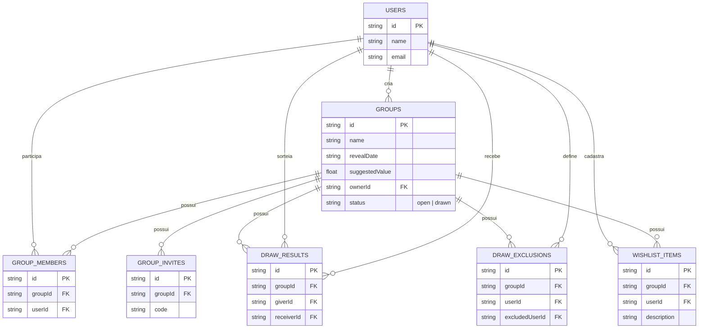

# 🛠️ Software Design Document (SDD)

**Projeto:** Revela
**Versão:** 1.2.0
**Última atualização:** 2026-10-16

> 🤖 O `prd.md` responde **o que** o produto faz. Este documento responde **onde as coisas moram e como se chamam**.
>
> Detalhes específicos de tela, rotas, componentes e contratos de cada funcionalidade serão definidos nas respectivas especificações `.spec.md`.

---

## 🤖 1. Fontes de Contexto para a IA

> Onde a IDE agêntica busca a verdade. Este documento funciona como índice; as configurações reais ficam nos arquivos correspondentes.

| Fonte | Onde configurar | Serve para |
| :--- | :--- | :--- |
| Regras do agente | `AGENTS.md` na raiz | Orientar a IA a ler o PRD e o SDD antes de escrever código |
| Design (Figma/Stitch) | Link público do arquivo de design | Cores, tipografia, componentes e hierarquia visual |
| GitHub MCP | Configuração pessoal da IDE (fora do repositório, nunca commitada) | Permitir que a IA consulte as Issues e informações do projeto |

### 📌 1.1. O arquivo `AGENTS.md`

O `AGENTS.md` já existe na raiz (vem do template da disciplina) e aponta para `.agents/rules/utf-rules.md`. Não é reescrito pela equipe. As regras específicas deste projeto vivem neste documento:

* Models só em `core/data/models/`.
* Dados só por repositories em `core/data/repositories/`; nenhum componente chama `HttpClient` ou SDK diretamente.
* Nomes de entidade seguem o Glossário Técnico (§5.1).
* Toda tela que busca dados trata carregamento, vazio e erro.
* Backend provisório é json-server: não gerar código de Supabase nesta etapa.

---

## 📦 2. Stack Tecnológica

> A stack deve permanecer alinhada ao `package.json`. Nenhuma dependência adicional deve ser introduzida sem necessidade e sem estar documentada.

**Frontend:**

* **Angular 22+**
* **Arquitetura Standalone** (sem `NgModules`)
* **Zoneless** (sem Zone.js)
* **Signals** para gerenciamento de estado (`signal()`, `computed()`, `model()`, `effect()`)
* **Fluxo de controle moderno:** `@if`, `@switch` e obrigatoriamente `@for (...; track item.id)`
* **Comunicação e DI:** `input()` e `output()` funcionais; injeção de dependências via `inject()`
* **Deferrable Views (`@defer`):** Opcional, aplicado pontualmente onde houver ganho real de desempenho de carregamento
* **Roteamento:** Lazy loading por rota de feature; `withComponentInputBinding()` para binding automático de parâmetros de rota em inputs; proteção de rotas exclusivamente com Functional Route Guards (`CanActivateFn`)

**Estilo:**

* **Tailwind CSS**
* **Lucide Angular**, caso seja necessário para iconografia

**Testes e Qualidade:**

* **Testes unitários:** **Vitest** (runner nativo do Angular CLI, compatível com arquitetura Zoneless)
* **Linter:** **ESLint** com regras oficiais `@angular-eslint`
* *Nota:* A configuração fina de scripts de teste e lint será injetada na fase de setup (`/utf-setup`).

**Dados Provisórios:**

* **json-server** (Mock REST API local servindo `apps/api/db.json` na porta 3000)

**Backend Futuro (Fase Final / Entrega 3):**

* **Supabase** (PostgreSQL relacional + Supabase Auth)
* Integração encapsulada nos repositories via SDK oficial (`@supabase/supabase-js`)
* Functional Interceptors para injeção de tokens JWT e tratamento global de erros HTTP adiados para a Entrega 3 (quando a autenticação real for incorporada)

---

### ⚠️ 2.1. Fonte de dados provisória

Durante esta etapa, o backend real ainda não está implementado. Os dados serão simulados utilizando `json-server`, servido como uma API REST local.

**Comando para execução:**

```bash
npm run api
```

> O json-server será instalado como devDependency (versão fixada no package.json).

### Limitações provisórias

| O que fingimos | A verdade atual | Issue para substituir |
| :--- | :--- | :--- |
| Existe autenticação | Não existe autenticação real no json-server. | A definir (Entrega 3) |
| Cada registro possui um dono | O json-server não aplica controle de propriedade ou permissões. | A definir (Entrega 3) |
| O servidor valida regras de negócio | O json-server não aplica as regras de negócio do Revela. | A definir (Entrega 3) |

> Essas limitações são provisórias e serão substituídas quando o Supabase e a autenticação entrarem na Entrega 3.

---

## 🎨 2.2. Design Tokens

Os tokens visuais (paleta, tipografia, espaçamento, estados, breakpoints e PWA) vivem em [`docs/design-tokens.md`](./design-tokens.md). Framework CSS: Tailwind CSS. Este documento não repete os valores.

---

## 🗂️ 3. Estrutura do Repositório

O projeto utiliza um monorepo para manter frontend e o mock de backend no mesmo repositório.

### Estrutura

```text
.
├── AGENTS.md
├── README.md
├── package.json
├── docs/
│   ├── prd.md
│   └── architecture.md
└── apps/
    ├── api/
    │   └── db.json
    └── web/
        └── src/
            ├── environments/
            │   ├── environment.ts
            │   └── environment.development.ts
            └── app/
                ├── core/
                │   ├── data/
                │   │   ├── models/       # TODOS os modelos e interfaces do sistema residem aqui
                │   │   └── repositories/ # Repositories de acesso a dados
                │   ├── guards/           # CanActivateFn
                │   └── services/         # Serviços de infraestrutura/estado global
                ├── shared/
                │   ├── components/       # Componentes visuais atômicos reutilizáveis
                │   ├── pipes/            # Pipes de formatação
                │   └── directives/       # Diretivas de UI
                └── features/
                    ├── auth/
                    │   ├── pages/
                    │   └── components/
                    ├── groups/
                    │   ├── pages/
                    │   └── components/
                    └── wishlist/
                        ├── pages/
                        └── components/
```

### Atalhos na raiz (`package.json`)

Nesta etapa, o `package.json` da raiz disponibiliza exclusivamente atalhos para execução das aplicações (os scripts de `test` e `lint` virão da etapa de setup):

```json
{
  "scripts": {
    "start": "npm --prefix apps/web start",
    "api": "json-server apps/api/db.json --port 3000"
  }
}
```

A execução local utiliza dois terminais:

```bash
npm run api
```

e:

```bash
npm start
```

---

## 🏗️ 4. Arquitetura Frontend

O código frontend reside em `apps/web/src/app/` e segue uma organização estritamente Feature-Driven:

### 🧩 4.1. Camadas da Aplicação

* **`core/`**: Elementos globais da aplicação (configuração, guards, services globais e a camada de acesso a dados `core/data/`).
  * **`core/data/models/`**: **Local único** de definição das interfaces e tipos de dados do domínio. Features **não** criam modelos próprios.
  * **`core/data/repositories/`**: Classes injetáveis responsáveis pela comunicação com a API REST / json-server (e futuramente com o SDK do Supabase).
* **`shared/`**: Elementos visuais e utilitários reutilizáveis e independentes de regra de negócio (botões, cards, modais, pipes de moeda/data, diretivas).
* **`features/`**: Funcionalidades de negócio verticais do Revela (páginas e componentes de apresentação). As features **não possuem** pasta `models/`.

### 📏 Regra Estrita de Dependência

* `features/` pode importar de `core/` e `shared/`.
* `shared/` **não** importa de `features/`.
* Uma feature **não** importa diretamente outra feature.
* Qualquer recurso que seja necessário para duas ou mais features deve ser avaliado e promovido para `shared/` (se for visual/utilitário) ou `core/` (se for dado/regra global).

---

### 🔌 4.2. Acesso aos Dados e Isolamento

Nenhum componente chama `HttpClient` ou serviços externos diretamente. O acesso aos dados é realizado exclusivamente por repositories em `core/data/repositories/`.

Exemplo:

```ts
@Injectable({ providedIn: 'root' })
export class GroupsRepository {
  private http = inject(HttpClient);
  private url = `${environment.apiUrl}/groups`;

  list(): Observable<Group[]> {
    return this.http.get<Group[]>(this.url);
  }

  create(input: Omit<Group, 'id'>): Observable<Group> {
    return this.http.post<Group>(this.url, input);
  }
}
```

Essa separação garante que a futura migração para o SDK `@supabase/supabase-js` fique restrita à camada de repositório, sem exigir alterações nos componentes de apresentação.

---

### 🌐 4.3. Endereço da API

O endereço da API é definido no arquivo de ambiente do Angular:

```ts
export const environment = {
  apiUrl: 'http://localhost:3000'
};
```

> 🔒 Nenhum segredo, chave privada ou credencial deve ser armazenado em `environment.ts`.

---

## 🗄️ 5. Arquitetura de Dados

### 📖 5.1. Glossário Técnico

Mapeamento rigoroso dos termos do negócio (`docs/prd.md`) para entidades técnicas em inglês:

| Termo PRD | Entidade técnica | Atributos principais | Mapeamento / Valores de Domínio |
| :--- | :--- | :--- | :--- |
| Usuário | `User` | `id`, `name`, `email` | Senha tratada pelo serviço de autenticação |
| Grupo | `Group` | `id`, `name`, `revealDate`, `suggestedValue`, `ownerId`, `status` | `status`: `'open'` ("Aguardando participantes") ou `'drawn'` ("Sorteado") |
| Participante | `GroupMember` | `id`, `groupId`, `userId` | Associação participante ao grupo |
| Convite | `GroupInvite` | `id`, `groupId`, `code` | Código único para adesão |
| Sorteio / Resultado | `DrawResult` | `id`, `groupId`, `giverId`, `receiverId` | Par gerado no sorteio (`giver` tirou `receiver`) |
| Exclusão | `DrawExclusion` | `id`, `groupId`, `userId`, `excludedUserId` | Restrição: `userId` não pode tirar `excludedUserId` |
| Item da Lista de Desejos | `WishlistItem` | `id`, `groupId`, `userId`, `description` | Sugestão de presente do participante no grupo |

---

### 📊 5.2. Diagrama ER



---

### 🗃️ 5.3. Mock de Dados (`db.json`)

Durante a fase provisória, o formato dos dados é centralizado em `apps/api/db.json`:

```json
{
  "users": [],
  "groups": [],
  "groupMembers": [],
  "groupInvites": [],
  "drawResults": [],
  "drawExclusions": [],
  "wishlistItems": []
}
```

> ⚠️ O `json-server` persiste alterações diretamente no arquivo `db.json` durante operações de escrita. Antes de commits, verificar alterações espúrias.

---

## 🗺️ 6. Mapa de Domínios e Rotas

As rotas são carregadas via lazy loading e utilizam `CanActivateFn` para controle de acesso:

| Domínio | Rota | Page Component | Guard | Dados (Repository) | User Story |
| :--- | :--- | :--- | :--- | :--- | :--- |
| Autenticação | `/login` | `LoginPageComponent` | — | `AuthRepository` | US02 |
| Autenticação | `/register` | `RegisterPageComponent` | — | `AuthRepository` | US01 |
| Grupos | `/groups` | `GroupsListPageComponent` | `authGuard` | `GroupsRepository` | US03 |
| Grupos | `/groups/new` | `GroupCreatePageComponent` | `authGuard` | `GroupsRepository` | US03 |
| Grupos | `/groups/:id` | `GroupDetailPageComponent` | `authGuard` | `GroupsRepository` | US04, US06, US08 |
| Grupos | `/groups/:id/draw` | `DrawResultPageComponent` | `authGuard` | `DrawRepository` | US07 |
| Grupos | `/join/:code` | `JoinGroupPageComponent` | `authGuard` | `InvitesRepository` | US05 |
| Desejos | `/groups/:id/wishlist` | `WishlistPageComponent` | `authGuard` | `WishlistRepository` | US09, US10 |

---

## 📅 7. Histórico

| Data | Versão | O que mudou |
| :--- | :--- | :--- |
| 2026-08-26 | 1.0.0 | Versão inicial do SDD para o projeto Revela. |
| 2026-10-12 | 1.1.0 | Alinhamento com `/utf-architecture`: Angular linha ativa com Zoneless; Vitest e ESLint formalizados; models centralizados em `core/data/models/`; `apps/api/` simplificado para `db.json`; status de grupos mapeado; interceptors/auth postergados para a Entrega 3. |
| 2026-10-16 | 1.2.0 | Ajustes: tokens movidos para design-tokens.md; AGENTS.md referenciado sem reescrita; versão do Angular em linha. |

---

## 🛑 O que ainda não está neste documento

A integração completa com o Supabase (Auth com tokens JWT, migração para banco PostgreSQL relacional hospedado em nuvem e Interceptors HTTP para injeção de credenciais) será implementada na **Entrega 3**, conforme o planejamento da disciplina.
